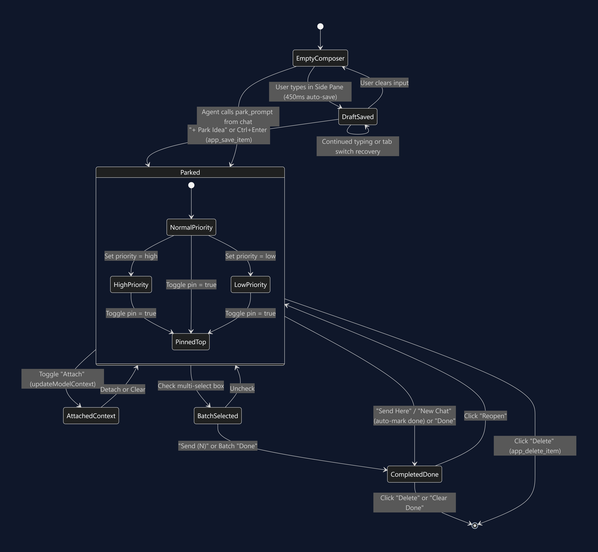
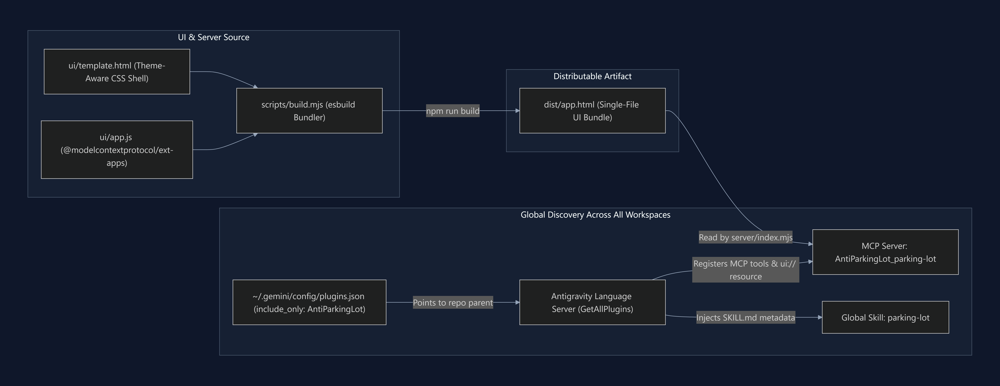

# AntiParkingLot Documentation

Welcome to the official documentation for **AntiParkingLot** (*Prompt Parking Lot*), an Antigravity **Plugin + Side-Pane MCP App** built to capture follow-up ideas while Antigravity is actively working—without interrupting active runs—and dispatch them with one click when you are ready.

---

## Documentation Guides

| Guide | Description |
| :--- | :--- |
| **[Installation Guide](./installation.md)** | Prerequisites, building the plugin, global Antigravity registration (`plugins.json` or `~/.gemini/config/plugins/`), updating, uninstalling, and troubleshooting. |
| **[Instructions & Conversations (`../instruction.md`)](../instruction.md)** | Quick-reference instructions explaining how Parking Lot interacts with conversations (`Send Here` vs `New Chat` vs `Attach`), voice input, and batch sending. |
| **[User Guide](./user-guide.md)** | Day-to-day workflow: opening the Side Pane while Antigravity works, keyboard shortcuts, draft auto-save, single vs. multi-idea batch sending, and project/priority filtering. |
| **[Architecture & Design](./architecture.md)** | Deep dive into the zero-interruption Side-Pane architecture, atomic file storage, `esbuild` single-file UI bundling, and global workspace registration. |
| **[MCP & Storage Reference](./mcp-reference.md)** | Complete schema reference for host/model MCP tools, `visibility: ["app"]` UI tools, the `ui://parking-lot/app.html` resource, and `parking_lot.json`. |

---

## Diagram Gallery (`4x` Resolution PNG + Mermaid Source)

All diagrams live in [`./diagrams/`](./diagrams/) in both editable **Mermaid (`.mmd`)** format and **4x resolution rasterized PNG (`.png`)** format. Re-render all PNGs anytime with:

```powershell
npm run build:diagrams
```

### 1. System & Plugin Architecture
- **Mermaid Source:** [`diagrams/01-system-architecture.mmd`](./diagrams/01-system-architecture.mmd)
- **4x PNG Image:** [`diagrams/01-system-architecture.png`](./diagrams/01-system-architecture.png)


---

### 2. Zero-Interruption Capture & Send Workflow
- **Mermaid Source:** [`diagrams/02-zero-interruption-workflow.mmd`](./diagrams/02-zero-interruption-workflow.mmd)
- **4x PNG Image:** [`diagrams/02-zero-interruption-workflow.png`](./diagrams/02-zero-interruption-workflow.png)


---

### 3. Idea Data Model & Item Lifecycle
- **Mermaid Source:** [`diagrams/03-data-model-and-lifecycle.mmd`](./diagrams/03-data-model-and-lifecycle.mmd)
- **4x PNG Image:** [`diagrams/03-data-model-and-lifecycle.png`](./diagrams/03-data-model-and-lifecycle.png)



---

### 4. Build & Global Plugin Discovery Pipeline
- **Mermaid Source:** [`diagrams/04-build-and-discovery-pipeline.mmd`](./diagrams/04-build-and-discovery-pipeline.mmd)
- **4x PNG Image:** [`diagrams/04-build-and-discovery-pipeline.png`](./diagrams/04-build-and-discovery-pipeline.png)


