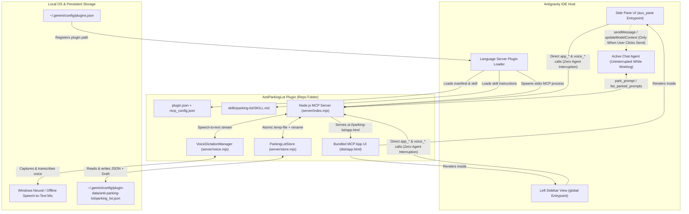
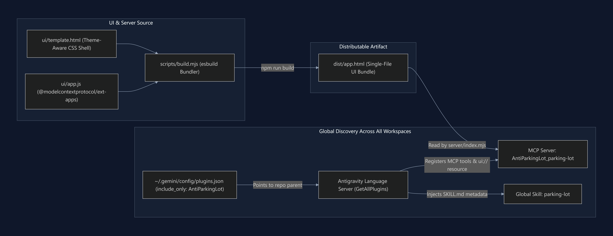

# Architecture & Design

**AntiParkingLot** is engineered around a strict UX requirement:

> _While Antigravity is busy executing a task, the user needs an always-ready scratchpad to type or voice-dictate ideas so they aren't forgotten—without interrupting or queueing behind the active agent run—and then send one or more parked ideas to Antigravity when ready._

---

## 1. High-Level System Architecture

_Source: [`diagrams/01-system-architecture.mmd`](./diagrams/01-system-architecture.mmd)_

### Key Architectural Layers

1. **Plugin Manifest & MCP Wiring (`plugin.json`, `mcp_config.json`):**
   - Declares the `anti-parking-lot` plugin metadata, square SVG icon (`assets/logo.svg`), suggested prompts, and stdio Node.js MCP server (`server/index.mjs`).
2. **Host-Integrated MCP App UI (`ui/template.html`, `ui/app.js` -> `dist/app.html`):**
   - Uses `@modelcontextprotocol/ext-apps` (`App`, `applyDocumentTheme`, `applyHostStyleVariables`) to inherit Antigravity's live dark/light theme tokens automatically.
   - Exposes both `aux_pane` (right-hand **Side Pane `+` menu**) and `global` (**Left Sidebar** full-page view) entrypoints via `_meta["com.google.antigravity/ui"]`.
3. **App-Scoped Tool Channel (`visibility: ["app"]`):**
   - All Side-Pane CRUD, draft auto-save, and voice dictation operations (`app_get_state`, `app_save_draft`, `app_save_item`, `app_set_status`, `app_reorder_item`, `app_delete_item`, `app_voice_*`) are marked `_meta: { ui: { visibility: ["app"] } }`.
   - These calls travel directly between the Side-Pane iframe and the local Node MCP process over JSON-RPC stdio—**completely bypassing the LLM conversation loop** while Antigravity is busy.
5. **Hybrid Speech-to-Text Engine (`server/voice.mjs` + `ui/app.js`):**
   - Sandboxed Electron iframes frequently restrict `webkitSpeechRecognition` or `getUserMedia`. `VoiceDictationManager` bypasses iframe limitations cleanly on Windows by driving WinRT `Windows.Media.SpeechRecognition.SpeechRecognizer` (neural/cloud speech with automatic punctuation) with an automatic offline fallback to `.NET System.Speech.Recognition.SpeechRecognitionEngine` (`DictationGrammar`), plus Web Speech API fallback on macOS/Linux.
6. **Atomic Persistence (`server/store.mjs`):**
   - Every mutation writes to `~/.gemini/config/plugin-data/anti-parking-lot/parking_lot.json.<pid>.tmp` and atomically renames over `parking_lot.json`, preventing partial writes or corruption.

---

## 2. Zero-Interruption Capture, Voice Dictation & Send Sequence

_Source: [`diagrams/02-zero-interruption-workflow.mmd`](./diagrams/02-zero-interruption-workflow.mmd)_

---

## 3. Build & Global Discovery Pipeline

_Source: [`diagrams/04-build-and-discovery-pipeline.mmd`](./diagrams/04-build-and-discovery-pipeline.mmd)_

- **Single-File UI Bundle (`scripts/build.mjs`):** Bundles `ui/app.js` and `@modelcontextprotocol/ext-apps` via `esbuild` (`format: "esm"`, `minify: true`) and inlines the resulting `<script type="module">` directly into `ui/template.html` to produce `dist/app.html`.
- **4x Resolution Diagram Renderer (`scripts/render-diagrams.mjs`):** Renders every `documentation/diagrams/*.mmd` source via headless Chromium + `mermaid` at `deviceScaleFactor: 4` into tightly cropped, high-DPI `.png` diagrams.
- **Zero-Copy Global Registration (`~/.gemini/config/plugins.json`):** Points Antigravity's plugin loader directly at `C:/Users/<user>/Repo_Pers/github` with `"include_only": ["AntiParkingLot"]`, making the plugin globally active across every workspace.
