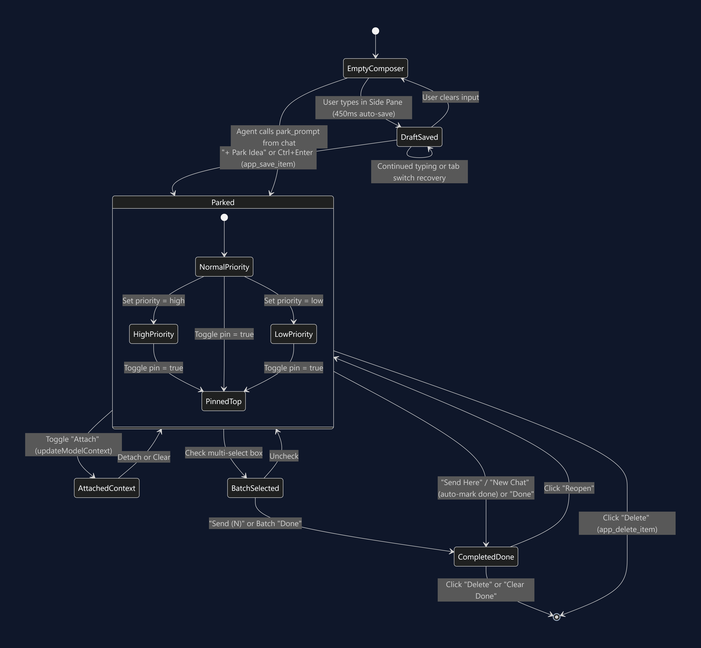

# User Guide

**Prompt Parking Lot** (`AntiParkingLot`) gives you a calm, persistent place to jot down or speak ideas while Antigravity is working so you never lose a train of thought or interrupt an active task.

---

## 1. Opening the Parking Lot

You can open **Parking Lot** in three ways:

1. **Side Pane (Recommended while Antigravity is working):**
   - Click the **`+`** button in the right-hand **Side Pane** header and choose **Parking Lot**.
   - Opening the panel from the `+` menu communicates directly with the plugin server—it **never** interrupts a running conversation.
2. **Left Sidebar (Full-Page Global View):**
   - Click **Parking Lot** in the Antigravity **Left Sidebar** to review and organize ideas across all projects at full width.
3. **From Chat (When Idle):**
   - Ask Antigravity: _"Open my Prompt Parking Lot"_.

---

## 2. Typing or Speaking Ideas Without Interrupting Antigravity

Once the Side Pane is open:

1. **Type or Dictate with Voice-to-Text (`🎤 Voice`):**
   - **In-App Voice Button (`🎤 Voice` or `Alt+V`):** Click **🎤 Voice** in the composer row and speak naturally. Your speech is transcribed directly into text inside the Parking Lot composer (using Windows Neural Speech Recognition with automatic offline `System.Speech` fallback—and browser Web Speech API fallback on macOS/Linux) without touching the active chat agent. Click **⏹ Stop** (or press `Alt+V` again) when finished.
   - **OS Voice Typing (`Win+H` / `Fn+Fn`):** Because the composer is a native `<textarea>`, Windows Voice Typing (`Win+H`) and macOS Dictation also stream punctuated speech directly into the box anytime.
   - **Auto-Saved Drafts:** As you type or dictate, your unsent draft is saved locally after 450 ms (`Draft saved`). If you close the pane or switch tabs mid-thought, your text is restored automatically when you return.
1. _(Optional)_ Add metadata before parking:
   - **Project:** Tag with a workspace/project name (autocomplete suggests existing project tags).
   - **Priority:** `🔥 High`, `⚡ Normal` (default), or `🧊 Low`.
   - **Optional note:** Add file names, line numbers, or quick reminders.
   - **📌 Pin:** Keep critical items pinned to the top of your list.
1. Press **`Ctrl+Enter`** (`Cmd+Enter` on macOS) or click **+ Park Idea**.

---

## 3. Sending Ideas When You Are Ready

When Antigravity finishes its current task (or whenever you want to spin off a parallel thread), every parked card gives you four ways to use it:

| Action          | Behavior                                                                                                                                                                          |
| :-------------- | :-------------------------------------------------------------------------------------------------------------------------------------------------------------------------------- |
| **▶ Send Here** | Sends the parked idea directly into your **current conversation** (including any context note). Automatically marks the card **Done** when _Mark done on send_ is checked.        |
| **↗ New Chat**  | Starts a **brand-new conversation** in the current project with that idea immediately—great for launching an independent task even while your current conversation is still busy! |
| **📎 Attach**   | Attaches one or more parked ideas as background context to your **next** chat message so you can type extra instructions in the main chat input.                                  |
| **📋 Copy**     | Copies the formatted prompt text to your clipboard.                                                                                                                               |

### Combining Multiple Ideas into One Prompt

Often during a 10-minute agent run, you will jot down or speak two or three related tweaks. Instead of sending them one by one:

1. Check the selection box at the top-left of 2 or more parked cards.
2. Use the **Batch Action Bar** that appears above the list:
   - **▶ Send (N):** Combines all selected ideas into a clean numbered prompt (`1. ... 2. ...`) and sends it to the current chat.
   - **↗ New Chat (N):** Starts a new conversation with all selected ideas combined.
   - **📋 Copy:** Copies the numbered list to your clipboard.
   - **✓ Done:** Marks all selected cards Done at once.

---

## 4. Lifecycle & Organization

_Source: [`diagrams/03-data-model-and-lifecycle.mmd`](./diagrams/03-data-model-and-lifecycle.mmd)_

- **Reorder (`↑` / `↓`):** Move parked items up or down manually.
- **Pin (`📌`):** Pinned items always stay at the top of the **Parked** list above unpinned items.
- **Edit (`✎`):** Refine the prompt text, project tag, priority, or notes inline before sending.
- **Tabs & Filters:** Switch between **Parked**, **Done**, and **All**, filter by **Project**, or instant-search across titles, prompt bodies, notes, and tags.
- **Reopen / Clear Done:** Reopen any completed item from the **Done** tab (`↩ Reopen`), or click **Clear Done** to prune finished items.
